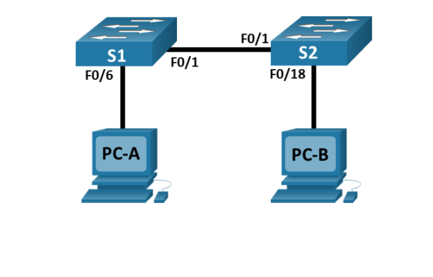
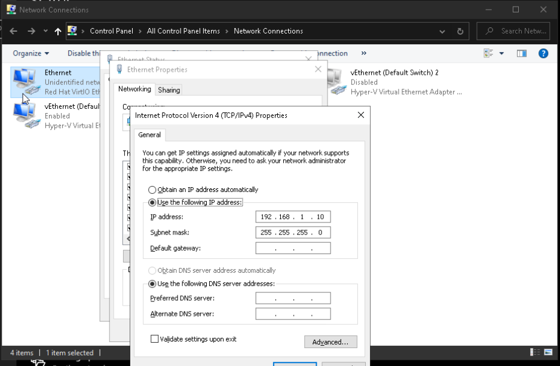

# CCNA 2.9.2 — Basic Switch and End Device Configuration

## Project Overview

This project documents my hands-on experience configuring a basic Cisco switched network using NETLAB+ as part of my CCNA studies.

The lab consists of two Cisco switches (S1 and S2) and two end devices (PC-A and PC-B).

The purpose of this lab is to develop practical skills in IPv4 addressing, Cisco IOS configuration, Layer 2 switching, network connectivity verification, and troubleshooting.

## Network Topology

The network consists of the following connections:

- S1 FastEthernet0/1 connects to S2 FastEthernet0/1.
- S1 FastEthernet0/6 connects to PC-A.
- S2 FastEthernet0/18 connects to PC-B.

## IP Addressing Scheme

| Device | Interface | IPv4 Address | Subnet Mask |
|---|---|---|---|
| S1 | VLAN 1 | 192.168.1.1 | 255.255.255.0 |
| S2 | VLAN 1 | 192.168.1.2 | 255.255.255.0 |
| PC-A | NIC | 192.168.1.10 | 255.255.255.0 |
| PC-B | NIC | 192.168.1.11 | 255.255.255.0 |

### PC-A Static IPv4 Configuration

I configured PC-A with the following settings:
- IP Address: 192.168.1.10
- Subnet Mask 255.255.255.0
- Default gateway is not required, all end points on same subnet

## Technical Skills Covered

- Static IPv4 addressing
- Cisco IOS command-line configuration
- Switch Virtual Interface (SVI) management
- Layer 2 Ethernet switching
- Network connectivity testing
- Troubleshooting and verification

## Lab Environment

**Platform:** NETLAB+  
**Course:** Cisco CCNA  
**Lab:** 2.9.2 — Basic Switch and End Device Configuration

## Configuration and Verification

Configuration screenshots, command outputs, and connectivity test results will be added as the lab progresses.
